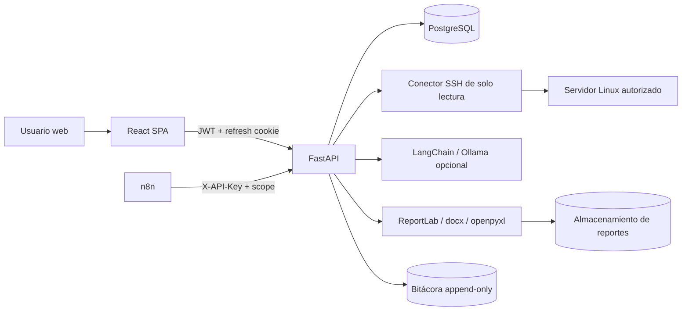

# CIS Hardening Auditor

Plataforma web para auditar de forma continua la configuración de servidores Linux frente a un
catálogo de controles inspirado en CIS Benchmarks. Diseñada para PYMES y equipos pequeños de
seguridad que necesitan evidencia trazable sin desplegar un agente ni ejecutar cambios automáticos.

> **Límite importante:** el porcentaje de cumplimiento mide únicamente los controles del perfil que
> pudieron evaluarse. No es una certificación CIS ni una garantía de que el servidor sea seguro.

## Estado de la entrega

| Componente | Estado |
| --- | --- |
| PostgreSQL + Alembic | Esquema de 23 tablas y 2 migraciones aplicadas |
| Backend FastAPI | Auth, RBAC, servidores, perfiles, motor SSH, scoring, hallazgos, IA, reportes, bitácora, automatización |
| Frontend React | Build de producción correcto; 15 vistas + login/setup/reset |
| Pruebas backend | **18 pruebas aprobadas** |
| Reportes | PDF, Word y Excel generados y verificados por firma de archivo |
| n8n | 4 workflows importados correctamente con n8n 2.8.4 |
| Ollama | Integración opcional; la ruta de indisponibilidad está probada. No se generó IA real en este entorno |
| SSH real | Conector implementado y bloqueo anti-SSRF probado; no se dispuso de un host SSH real para validar una sesión |
| Docker | `docker compose config` válido; ver instrucciones de build |

## Funcionalidad principal

- **Inventario autorizado** de servidores con confirmación explícita de autorización.
- **Credenciales SSH cifradas** con Fernet y clave externa a PostgreSQL.
- **Verificación de huella de host SSH** (SHA256) antes de aceptar la conexión.
- **Motor de solo lectura** con comandos estáticos, límites de tiempo, salida acotada y bloqueo
  anti-SSRF.
- **14 controles iniciales** de Ubuntu/Linux, con identificadores CIS contrastados y controles
  internos marcados como tales.
- **Scoring transparente**: aprobados / (aprobados + incumplidos). No aplicables y no evaluados se
  informan por separado y nunca cuentan como aprobados.
- **Hallazgos con ciclo de vida**, responsable, prioridad, vencimiento, eventos y cierre respaldado
  por una nueva comprobación o justificación de administrador.
- **Recomendaciones con LangChain + Ollama** en JSON validado, con detección de comandos peligrosos
  y revisión humana obligatoria. Jamás se ejecutan comandos.
- **Reportes PDF/Word/Excel** técnicos y ejecutivos, con checksum SHA-256 y advertencia de datos
  simulados cuando corresponde.
- **Dashboard** alimentado por PostgreSQL, sin datos ficticios en el frontend.
- **Bitácora append-only** protegida por trigger de PostgreSQL.
- **Automatización n8n** mediante API keys con alcance limitado.
- **Primer arranque seguro**: no hay usuario ni contraseña predeterminados; el administrador se crea
  desde la pantalla de setup.

## Stack

| Capa | Tecnología | Justificación |
| --- | --- | --- |
| Frontend | React 18 + TypeScript + Vite + Tailwind CSS + Recharts | SPA tipada, build rápido y visualización de tendencias |
| Backend | FastAPI + Pydantic v2 | Validación estricta, OpenAPI y dependencias de autorización explícitas |
| Persistencia | PostgreSQL 17 + SQLAlchemy 2 + Alembic | Integridad relacional, JSONB para evidencia y migraciones versionadas |
| SSH | Paramiko | Verificación de huella, timeouts y ejecución no interactiva |
| IA | LangChain + Ollama | Modelo local opcional, salida JSON validada y sin herramientas de ejecución |
| Automatización | n8n | Orquestación visual y reintentos, llamando solo a endpoints autenticados |
| Reportes | ReportLab, python-docx, openpyxl | Generación local sin servicios externos |
| Infraestructura | Docker + Compose + Nginx | Instalación reproducible y proxy con cabeceras de seguridad |

### Decisiones deliberadas

- **No se usa OpenSCAP en la v1.** Añade complejidad de perfiles, dependencias y interpretación de
  resultados que no se justifica para un MVP agentless. El motor implementa controles verificables
  y deja abierta la integración futura como conector adicional.
- **n8n no calcula el score ni escribe SQL.** Solo dispara endpoints. La lógica y las validaciones
  viven en el backend.
- **La IA no tiene herramientas.** Recibe contexto acotado y devuelve una propuesta. No puede
  conectar a servidores ni ejecutar acciones.
- **Los controles internos se etiquetan como internos.** Los identificadores CIS se contrastaron con
  el PDF oficial de CIS Ubuntu Linux 22.04 LTS v1.0.0; no se inventaron referencias.

## Arquitectura resumida



El detalle está en [docs/ARCHITECTURE.md](docs/ARCHITECTURE.md).
Consulta el [experimento de auditorías](experimento/README.md) para ver su metodología, dataset y resultados.

## Inicio rápido local

Requisitos: Python 3.11+, Node.js 20+, PostgreSQL 15+ y, opcionalmente, n8n/Ollama.

```powershell
# 1. Configuración
Copy-Item .env.example .env
# Edite .env con DB_*, SECRET_KEY y FERNET_KEY. No use los marcadores de ejemplo.

# 2. Dependencias backend
cd backend
python -m venv .venv
.\.venv\Scripts\Activate.ps1
pip install -r requirements.txt

# 3. Base de datos
python -m alembic upgrade head

# 4. API
uvicorn app.main:app --host 127.0.0.1 --port 8000
```

En otra terminal:

```powershell
cd frontend
npm install
npm run dev
```

Abra `http://127.0.0.1:5173`. La primera pantalla solicita crear la organización y el administrador;
no existen credenciales por defecto. Los detalles y solución de problemas están en
[docs/INSTALL.md](docs/INSTALL.md).

## Docker Compose

```powershell
# Núcleo: PostgreSQL + API + SPA
docker compose up -d --build

# Automatización con n8n
docker compose --profile automation up -d

# IA local con Ollama (descargue el modelo una vez)
docker compose --profile ai up -d
docker compose exec ollama ollama pull llama3.1:8b
```

- Aplicación: `http://127.0.0.1:8080`
- API y documentación de desarrollo: `http://127.0.0.1:8000/api/docs`
- n8n: `http://127.0.0.1:5678`

Para producción: HTTPS, `COOKIE_SECURE=true`, `ENVIRONMENT=production`, conector simulado
desactivado, CORS restringido y respaldos de PostgreSQL + clave Fernet. Ver
[docs/SECURITY.md](docs/SECURITY.md).

## Automatización n8n

Los flujos exportables están en [`n8n/workflows`](n8n/workflows):

1. **A — Auditoría programada**: cada 15 minutos llama a `POST /automation/audits/run-due`.
2. **B — Recomendaciones IA**: solicita propuestas sin aprobarlas ni ejecutarlas.
3. **C — Hallazgos persistentes**: prepara alertas sin cambiar estados automáticamente.
4. **D — Reportes**: genera reportes ejecutivos por lote y consulta el histórico.

Importación, credencial HTTP Header Auth y alcances en [docs/N8N.md](docs/N8N.md).

## Controles iniciales

Los 14 controles, su referencia CIS (cuando existe), límites del parser y criterios de aceptación
están documentados en [docs/CONTROLS.md](docs/CONTROLS.md). El alcance validado es Ubuntu 22.04/24.04
con OpenSSH y APT; el motor no modifica configuraciones.

## Estructura del repositorio

```text
backend/
  app/
    api/v1/          Routers FastAPI
    core/            JWT, cifrado, rate limit, middlewares
    services/        Motor SSH, checks, scoring, IA, reportes, runner
    schemas/         Modelos Pydantic
    models.py        Modelo relacional SQLAlchemy
  alembic/           Migraciones versionadas
  tests/             Pruebas unitarias e integración
frontend/
  src/pages/         Vistas de la consola
  src/components/    UI, navegación, formularios
  src/lib/           Cliente API, formato, queries
n8n/workflows/       Flujos importables
docker/              Init de PostgreSQL
docs/                Arquitectura, API, seguridad, operación, ejemplos
```

## Documentación

- [Instalación y configuración](docs/INSTALL.md)
- [Arquitectura y modelo de datos](docs/ARCHITECTURE.md)
- [API](docs/API.md)
- [Seguridad y modelo de amenazas](docs/SECURITY.md)
- [Controles CIS y controles internos](docs/CONTROLS.md)
- [Manual de usuario](docs/USER_GUIDE.md)
- [Operación, respaldos y recuperación](docs/OPERATIONS.md)
- [n8n](docs/N8N.md)
- [Pruebas y resultados](docs/TESTING.md)
- [Ejemplos de reportes](docs/ejemplos/README.md)

## Limitaciones conocidas

- El alcance verificado es Ubuntu 22.04/24.04. Otros sistemas Linux requieren revisar comandos y
  mapeos antes de usarse.
- El parser SSH es conservador: configuraciones incluidas mediante `Include`, PAM personalizado o
  contenedores sin `systemd` pueden quedar como **no evaluadas**.
- No se validó una sesión SSH contra infraestructura real en este entorno; sí se probó el bloqueo
  de objetivos no autorizados y el fallo cerrado.
- La generación real con Ollama depende de un modelo instalado; sin él, la plataforma sigue
  auditando y devuelve un error controlado en recomendaciones.
- El rate limiting de autenticación es en memoria; con varias réplicas debe moverse a Redis o al
  reverse proxy.
- El worker de auditorías es en proceso. Para varias réplicas se recomienda un worker dedicado
  (Celery/RQ) y una cola.
- La bitácora es append-only a nivel de trigger; un superusuario de PostgreSQL puede deshabilitarlo.
  Restrinja privilegios y almacene copias externas.

## Pruebas

```powershell
$env:PYTHONPATH='backend'
python -m pytest backend/tests -q
```

Resultado actual: **18 passed**. Cobertura funcional en [docs/TESTING.md](docs/TESTING.md).
