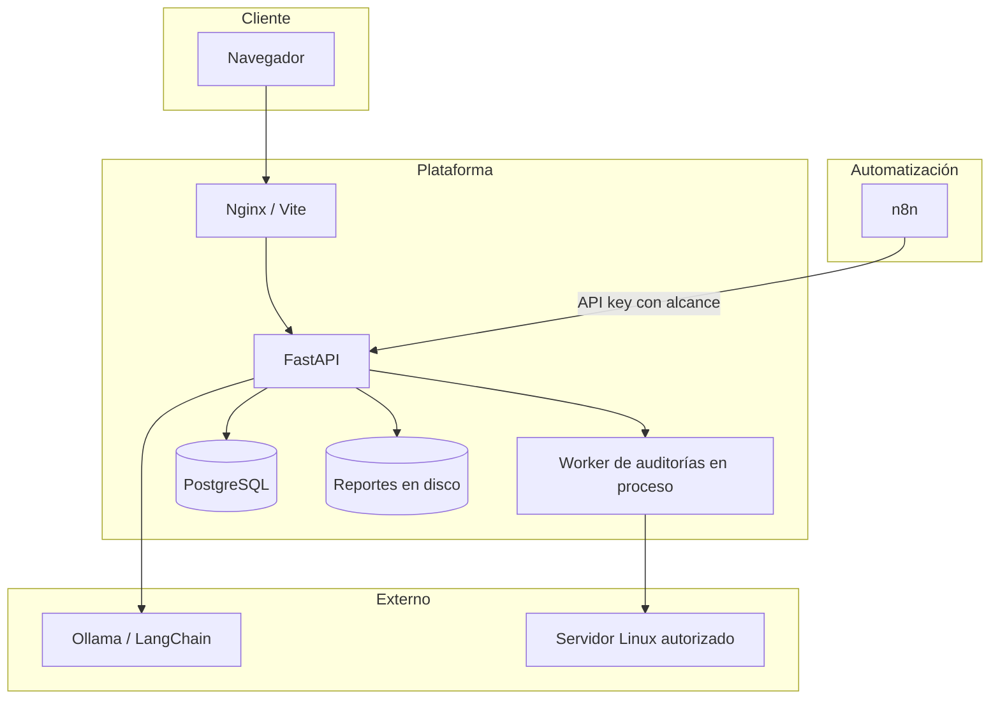
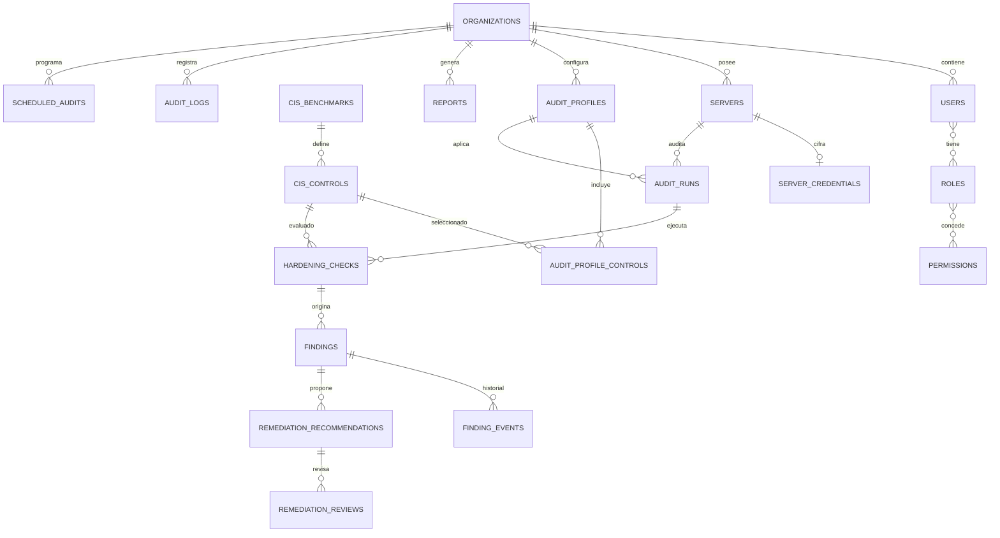
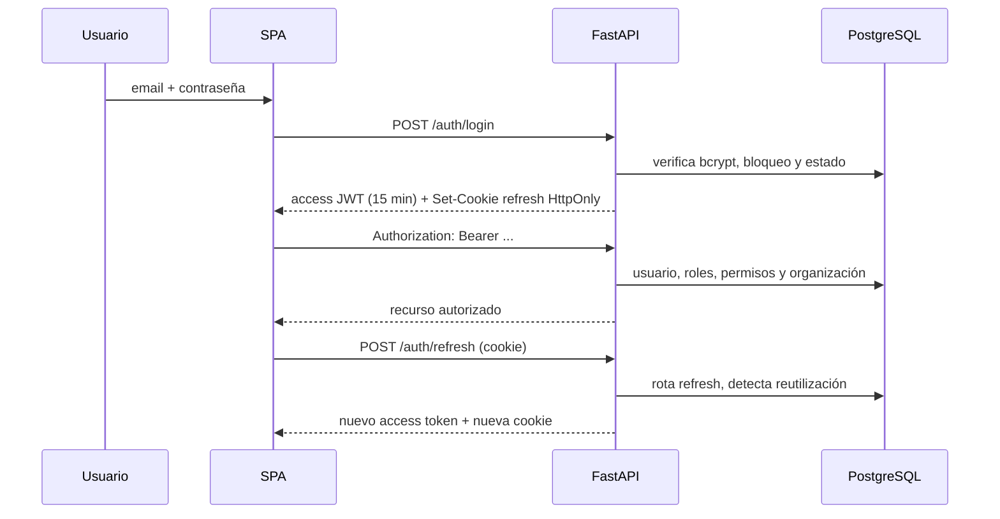
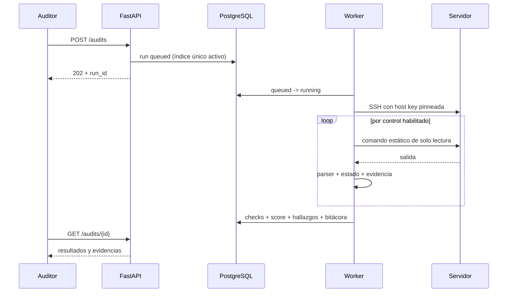
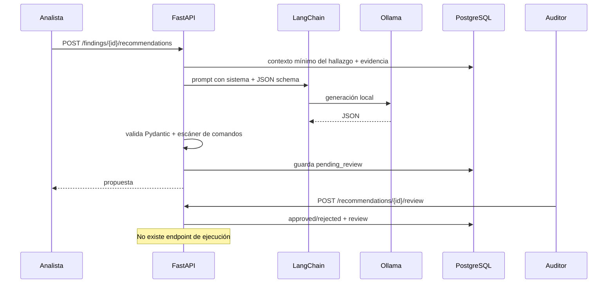

# Arquitectura

## 1. Contexto

CIS Hardening Auditor es una aplicación monolítica modular:

- **SPA React** servida por Vite en desarrollo o Nginx en producción.
- **API FastAPI** con Sync SQLAlchemy y ejecución de auditorías en un worker en proceso.
- **PostgreSQL** como fuente de verdad, cola ligera de ejecuciones y bitácora.
- **n8n** como orquestador opcional de programaciones, no como motor de seguridad.
- **Ollama** como proveedor local de IA opcional, aislado del plano de ejecución.
- **Servidores Linux** contactados por SSH de solo lectura.



## 2. Componentes

### 2.1 Frontend

- React 18 + TypeScript + Vite.
- React Router para las rutas protegidas.
- TanStack Query para caché y revalidación.
- Tailwind CSS para estilos; Recharts para la evolución del cumplimiento.
- El token de acceso vive en memoria, nunca en `localStorage`.
- La cookie de refresco es `HttpOnly`, `SameSite=Lax` y `Secure` en producción.
- Cada página consume endpoints reales; no hay arrays de métricas ficticias.

### 2.2 API

Routers principales:

| Router | Responsabilidad |
| --- | --- |
| `/auth`, `/setup` | Setup inicial, login, refresh, logout, cambio de contraseña |
| `/servers` | Inventario, autorización, credenciales cifradas, test de conexión |
| `/profiles`, `/benchmarks` | Catálogo y perfiles versionados |
| `/audits`, `/schedules` | Ejecuciones, evidencias, programación |
| `/findings`, `/recommendations` | Ciclo de vida y revisión de IA |
| `/reports` | Generación y descarga |
| `/dashboard` | Agregaciones desde PostgreSQL |
| `/users`, `/roles`, `/organizations` | RBAC y scoping |
| `/audit-logs` | Bitácora |
| `/settings` | Estado y API keys de n8n |
| `/automation` | Endpoints acotados para n8n |

### 2.3 Worker de auditoría

`services/audit_runner.execute_audit_run` se ejecuta en el threadpool de Starlette mediante
`BackgroundTasks`. Pasos:

1. Transición atómica `queued -> running`.
2. Carga servidor, credencial descifrada, perfil y controles.
3. Verifica autorización y política de red.
4. Conecta por SSH, valida huella SHA256 y ejecuta cada comando estático.
5. Evalúa la salida con un parser conservador.
6. Guarda `hardening_checks` con evidencia acotada.
7. Calcula score y cobertura.
8. Crea/actualiza/resuelve hallazgos según los estados.
9. Actualiza servidor, programación y bitácora.

La restricción de una ejecución activa por servidor se implementa con un índice único parcial:

```sql
CREATE UNIQUE INDEX uq_audit_runs_active_server
ON audit_runs (server_id)
WHERE status IN ('queued', 'running');
```

### 2.4 Modelo de datos

Entidades centrales:



Separación deliberada:

- `cis_controls`: **definición** versionada del requisito.
- `audit_runs`: **ejecución** y snapshot del benchmark.
- `hardening_checks`: **resultado** de un control en una ejecución + evidencia.
- `findings`: **incumplimiento persistente** con ciclo de vida.
- `remediation_recommendations`: **propuesta revisable**, nunca ejecución.
- `audit_logs`: **evento inmutable** de operación.

Se usan UUID para entidades de negocio, `JSONB` para evidencia/config, índices parciales para
hallazgos activos y ejecuciones activas, y claves foráneas con `RESTRICT`/`SET NULL` según la
necesidad de conservación histórica.

### 2.5 Flujo de autenticación



El backend comprueba permisos en cada endpoint. Ocultar un botón en React es solo una mejora de UX,
no un control de acceso.

### 2.6 Flujo de auditoría



Si el comando no puede evaluarse, el control queda `not_evaluated`; no se marca aprobado. Si no hay
controles aplicables evaluados, el score es `null`, nunca 100.

### 2.7 Flujo de recomendaciones



## 3. Decisiones de seguridad

| Decisión | Motivo |
| --- | --- |
| Comandos en una lista blanca del código | Elimina inyección de shell desde datos de usuario |
| Conexión por IP validada, no por DNS | Evita DNS rebinding y SSRF por nombres |
| Bloqueo de loopback/link-local/metadata | Protege la red interna de la plataforma |
| Huella SHA256 obligatoria | Evita aceptar un host suplantado |
| Credenciales Fernet fuera de la BD | Reduce impacto de un dump de PostgreSQL |
| JWT corto + refresh rotativo | Limita ventana de robo de token |
| Bitácora con trigger append-only | Detecta y bloquea intentos de alteración |
| IA sin herramientas y sin ejecución | Convierte el modelo en asesor, no en operador |
| Reportes con limitaciones y sin secretos | Evita falsas expectativas y filtración |
| API keys con scopes | n8n no recibe permisos de administración |

## 4. Escalabilidad y límites

- El worker en proceso es suficiente para una PYME con pocas decenas de servidores.
- Para múltiples réplicas, mover `execute_audit_run` a un worker dedicado y sustituir el semáforo
  local por una cola persistente.
- El rate limiting de login debe moverse a Redis si hay más de una réplica.
- Las consultas del dashboard calculan varios agregados por servidor. Para miles de servidores,
  materializar vistas o usar tablas de resumen.
- El almacenamiento de reportes es local; en clúster usar object storage con URLs firmadas.

## 5. Trazabilidad y conservación

- Los reportes guardan checksum SHA-256 y parámetros de generación.
- Los runs conservan la versión del benchmark y el perfil usados.
- Los hallazgos resueltos permanecen; una nueva falla genera un nuevo registro activo.
- Los logs no se actualizan ni eliminan desde la aplicación.
- Los borrados de organizaciones no están expuestos en la API; se desactivan usuarios y servidores.

## 6. Referencias internas

- [Modelo relacional](../backend/app/models.py)
- [Migración inicial](../backend/alembic/versions/c8f949a9645c_initial_schema.py)
- [Catálogo de controles](../backend/app/reference_data.py)
- [Motor SSH](../backend/app/services/ssh_connector.py)
- [Comprobaciones](../backend/app/services/checks.py)
- [Runner](../backend/app/services/audit_runner.py)
- [Seguridad](SECURITY.md)
